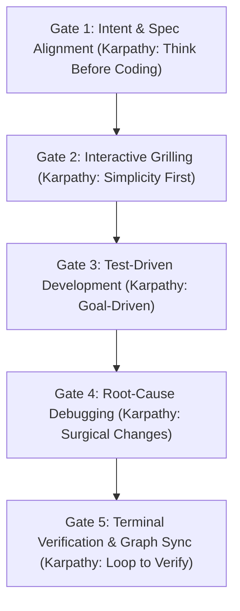

# SME Finance Copilot — Engineering Rules & Operational Protocol

Scope: All software development, research, financial analysis, and architecture in this workspace.

---

## 0. Project Truth & Engineering Documentation

Start with [`AGENTS.md`](AGENTS.md) and the user's explicit task. `AGENTS.md` defines project-document precedence and the verified implementation baseline. For first-demo work, [`docs/team_execution_plan.md`](docs/team_execution_plan.md) is the target contract—not proof the endpoint, UI, or integration is implemented. Read only relevant blueprint sections and applicable ADRs; do not treat future architecture as task scope by default. Verify behavior in current source/tests, and check whether generated `graphify-out/` artifacts are fresh before relying on them. If the explicit task and target contract cannot be reconciled, ask rather than silently choosing.

### Relevant references
- [`docs/system.md`](docs/system.md): System design blueprint.
- [`docs/architecture.md`](docs/architecture.md): Architecture blueprint.
- [`docs/security.md`](docs/security.md): Security design blueprint.
- [`docs/team_distribution_guide.md`](docs/team_distribution_guide.md): Team handoffs; the execution plan owns the current first-demo contract.
- [`docs/adr/`](docs/adr/): Accepted decisions, when applicable.
- [`.agent/workflows/sprint-workflow.md`](.agent/workflows/sprint-workflow.md): Task workflow.

---

## 1. Mandatory Invariants for Every Project

Every contributor (human developer or AI coding agent) working in this workspace must adhere to these standing invariants without exception:

### 1.1 Knowledge Graph Synchronization (`graphify`)
- The knowledge graph is located at `graphify-out/`.
- For codebase architecture questions, query the graph first via `graphify query "<question>"` or inspect `graphify-out/wiki/index.md`.
- After source-code changes, run `python -m graphify update .` when Graphify is available; this command refreshes the code graph, not semantic documentation/wiki content. Documentation-only edits do not require a code-graph rebuild. Report Graphify extraction blockers or stale generated artifacts plainly.

### 1.2 Internet Research Routing (`agent-reach`)
- When internet research, web page extraction, repository inspection, video transcription, or social lookup is requested:
  - Route through Agent Reach zero-config channels: Jina Reader (`curl -s "https://r.jina.ai/<URL>"`), GitHub CLI (`gh search repos`, `gh repo view`), `yt-dlp` for YouTube.
  - Never invent ad-hoc scrapers or forge authentication cookies.
  - **Strictly Read-Only**: Fetch and read content only; never perform write actions.
  - **Workspace Hygiene**: Never write temporary search files into project directories; use Windows `%TEMP%` or `C:\Users\Sam\.agent-reach\`.

### 1.3 Anti-Slop & Writing Discipline (`antislop` & `no-ai-slop`)
- **UI & Visuals Purpose Gate**: Avoid ungrounded glow, arbitrary neon gradients, and nested card layouts. Respect project design tokens.
- **Copy & Prose**: Eliminate fake testimonials, AI sparkle emojis, and speculative marketing claims. Write direct, factual prose.
- **Banned Vocabulary**: Never use words like *delve, foster, leverage, utilize, facilitate, empower, streamline, robust, cutting-edge, paradigm shift, supercharge, harness*.
- **Code Comments**: Never write comments that merely restate function or variable names. Document architectural constraints and non-obvious failure modes only.

### 1.4 Senior Developer Ladder (`ponytail`)
- Before writing code, climb the Ladder:
  1. *YAGNI*: Does this need to be built at all?
  2. *Reuse*: Does a helper or pattern already exist in this codebase?
  3. *Standard Library*: Does Python/Node stdlib already cover it?
  4. *Native Platform*: Does a platform feature handle it?
  5. *Installed Dependencies*: Does an existing package solve it?
  6. *Minimal Diff*: Write the shortest working diff that solves the root cause.

### 1.5 Domain Alignment & ADR Protocol (`domain-alignment`)
- Enforce ubiquitous domain vocabulary in all code, data models, and API routes.
- Record non-trivial architectural decisions in Architecture Decision Records (`docs/adr/ADR-xxx.md`).
- Maintain domain definitions in [`GLOSSARY.md`](GLOSSARY.md).

### 1.6 Frontend Design Engineering (`frontend-craft`)
- Enforce the 4-pillar design protocol: Taste, Impeccable finish, Emil Kowalski motion physics (<300ms spring transitions), and Vercel A11y standards.
- Mandatory 4-state component coverage: loading skeleton, empty guidance, error with retry, and populated data view.
- Format all financial figures using monospace tabular numbers (`font-variant-numeric: tabular-nums`).

### 1.7 ADHD-Friendly Communication Protocol (`i-have-adhd`)
- **Lead With the Next Action**: First line is always a concrete action (command, file path, snippet, decision).
- **Number Multi-Step Tasks**: Bounded 1-2-3 action lists with verification check per step.
- **End With One Concrete Next Action**: Name ONE task the user can do in under two minutes.
- **Suppress Tangents**: Finish primary task before raising secondary topics.
- **Restate State Every Turn**: State active step explicitly (e.g. "Step 2 of 4 done: tests passing. Next: ...").
- **Concrete Time Estimates**: Give estimates in minutes/hours, never vague phrases.
- **Cap Lists to 5 Items**: Group visible lists into chunks of at most 5 items.
- **Zero Preamble & Zero Pleasantries**: No "Sure!", "Great question", or closing pleasantries. Lead with the answer.

---

## 2. The Andrej Karpathy × Superpowers Engineering Lifecycle

Every development task must pass through the **Andrej Karpathy Behavioral Guidelines** integrated with the **Superpowers 5-Gate Protocol**. No feature, refactor, or bugfix may skip any gate:

### Detailed Phase Breakdown: When to Use Which Agent, Skill, and Rule

| Gate / Phase | Karpathy Principle | When to Use Which Agent | When to Use Which Skill | Optimized Rules Enforced |
|---|---|---|---|---|
| **Gate 1: Intent & Spec Alignment** | **1. Think Before Coding**: Never guess or implement silently; clarify ambiguous intent upfront. | • [`prompt-engineer`](.agent/agents/0-global-specialists/prompt-engineer.md) for vague prompts. • [`research-scout`](.agent/agents/0-global-specialists/research-scout.md) for external docs. • [`research-analyst`](.agent/agents/7-research-intelligence/research-analyst.md) for domain concepts. | • [`writing-plans`](.agent/skills/writing-plans) for multi-step tasks. • [`brainstorming`](.agent/skills/brainstorming) for new features. • [`karpathy-guidelines`](.agent/skills/karpathy-guidelines) to surface assumptions. | [`superpowers.md`](.agent/rules/superpowers.md) (Intent Gate), [`multi-agent-orchestrator.md`](.agent/rules/multi-agent-orchestrator.md) (Thoughtful Collaborator). |
| **Gate 2: Interactive Grilling & Consultation** | **2. Simplicity First**: Minimum code that works; question complex requests and propose simpler alternatives. | • [`first-principles-thinking`](.agent/agents/6-product-pitch/first-principles-thinking.md) to deconstruct complexity. • [`systems-architect`](.agent/agents/0-global-specialists/systems-architect.md) for trade-offs. | • [`grill-me`](.agent/skills/grill-me) for structured interviews. • [`doubt-driven-development`](.agent/skills/doubt-driven-development) for adversarial review. • [`antislop`](.agent/skills/antislop) to cut boilerplate. | [`ponytail.md`](.agent/rules/ponytail.md) (The Ladder), [`domain-alignment.md`](.agent/rules/domain-alignment.md), [`no-ai-slop.md`](.agent/rules/no-ai-slop.md). |
| **Gate 3: Test-Driven Development (TDD)** | **4. Goal-Driven Execution**: Define measurable test criteria before implementation; loop until green. | • [`fintech-engineer`](.agent/agents/2-fintech-engine/fintech-engineer.md) for decimal math. • [`fastapi-developer`](.agent/agents/3-backend-platform/fastapi-developer.md) for API routes. • [`test-automator`](.agent/agents/5-security-qa/test-automator.md) for test generation. | • [`source-driven-development`](.agent/skills/source-driven-development) for official doc grounding. • [`test-driven-development`](.agent/skills/test-driven-development) for Red-Green cycles. • [`pytest-financial-testing`](.agent/skills/pytest-financial-testing) for cash flow assertions. | [`superpowers.md`](.agent/rules/superpowers.md), [`multi-agent-orchestrator.md`](.agent/rules/multi-agent-orchestrator.md) (Anti-Rationalization Gate). |
| **Gate 4: Root-Cause Debugging** | **3. Surgical Changes**: Touch only what you must. Fix the shared function once; never patch symptoms. | • [`debugger`](.agent/agents/5-security-qa/debugger.md) to trace stack traces. • [`architect-reviewer`](.agent/agents/5-security-qa/architect-reviewer.md) for boundaries. • [`code-reviewer`](.agent/agents/0-global-specialists/code-reviewer.md) for diff minimization. | • [`systematic-debugging`](.agent/skills/systematic-debugging) (reproduce, isolate, fix, verify). • [`code-optimizer`](.agent/skills/code-optimizer) for hot-path latency. | [`superpowers.md`](.agent/rules/superpowers.md) (Root Cause Invariant), [`ponytail.md`](.agent/rules/ponytail.md) (Shortest diff wins). |
| **Gate 5: Terminal Verification & Sync** | **4. Goal-Driven Execution**: Run deterministic commands; require concrete terminal output; sync graph. | • [`qa-verifier`](.agent/agents/0-global-specialists/qa-verifier.md) for final pass/fail verdict. • [`security-auditor`](.agent/agents/5-security-qa/security-auditor.md) for permission audits. • [`compliance-auditor`](.agent/agents/5-security-qa/compliance-auditor.md) for truth-in-lending. | • [`verification-before-completion`](.agent/skills/verification-before-completion) for command proof. • [`graphify`](.agent/skills/graphify) to update knowledge graph. | [`superpowers.md`](.agent/rules/superpowers.md) (Verification Invariant), [`graphify.md`](.agent/rules/graphify.md) (Mandatory AST sync). |

---

## 3. FinTech Domain Invariants

* **Deterministic Decimal Arithmetic**: All financial calculations (Cash Runway, Monthly Burn, DSCR, DAB, APR, Cash Conversion Cycle) **MUST** use Python `decimal.Decimal` in isolated calculation services (`services/calculations/`). Free-text LLM mathematical approximations are strictly forbidden.
* **WeBank Digital Underwriting Linkage**: Replace traditional audited balance sheets with transactional data streams: Daily Average Balance (DAB), Non-Sufficient Funds (NSF) frequency, seasonal volatility indices, and B2B VAT e-invoice stability.
* **Truth-in-Lending Enforcement**: When matching financing options, convert factor rates (e.g., 1.25x) into true Annual Percentage Rate (APR). Flag any facility exceeding 36% APR as high-risk/predatory.

---

## 4. The 3-Tier Security Matrix (HITL Governance)

Every autonomous agent action must pass through the permission gatekeeper before execution:

* **Tier 1 (Observation — Autonomous)**: Read-only data ingestion (CSV parsing, bank statement OCR, ledger queries). Safe for unsupervised agent execution.
* **Tier 2 (Staging — Queue Only)**: Proposal preparation (drafting credit applications, generating invoice factoring offers, cash transfer staging). Placed in an immutable staging ledger; no money moves.
* **Tier 3 (Execution — Strict HITL 2FA)**: Irreversible financial transactions (drawing credit lines, wire transfers, digital contract signing). **STRICT REQUIREMENT**: System must halt and require explicit Human-in-the-Loop biometric/OTP verification.

---

## 5. Blockchain Audit Trail (FISCO BCOS +5 Pts)

* Generate cryptographic content hashes (`SHA-256`) for every B2B invoice upon ingestion.
* Maintain deterministic on-chain verification payloads to eliminate invoice double-financing across lenders on consortium blockchain networks (FISCO BCOS).

---

## 6. End-to-End Project Execution Workflows

### Workflow 1: Beginner Research & First-Principles Learning
- **When Triggered**: User asks questions about financial concepts ("What is cash conversion cycle?", "Why do profitable businesses fail?", "How does WeBank Weiyidai underwrite?").
- **Agent Flow**: `Lead Orchestrator` $\to$ [`research-scout`](.agent/agents/0-global-specialists/research-scout.md) $\to$ [`research-analyst`](.agent/agents/7-research-intelligence/research-analyst.md) $\to$ [`statement-auditor`](.agent/agents/7-research-intelligence/statement-auditor.md).
- **Skills Triggered**: [`agent-reach`](.agent/skills/agent-reach), [`sector-overview`](.agent/skills/sector-overview), [`earnings-analysis`](.agent/skills/earnings-analysis), [`deal-screening`](.agent/skills/deal-screening), [`dcf-model`](.agent/skills/dcf-model).
- **Output Standards**: Plain language, step-by-step analogies, exact mathematical formulas, zero ungrounded buzzwords.

### Workflow 2: SME Financial Health & Transaction Ingestion
- **When Triggered**: Ingesting bank transaction CSVs, accounting ledgers, or invoice records.
- **Agent Flow**: `Lead Orchestrator` $\to$ [`sme-cfo-diagnostician`](.agent/agents/2-fintech-engine/sme-cfo-diagnostician.md) $\to$ [`fintech-engineer`](.agent/agents/2-fintech-engine/fintech-engineer.md) $\to$ [`systems-architect`](.agent/agents/0-global-specialists/systems-architect.md).
- **Skills Triggered**: [`clean-data-xls`](.agent/skills/clean-data-xls), [`gl-recon`](.agent/skills/gl-recon), [`unit-economics`](.agent/skills/unit-economics), [`3-statement-model`](.agent/skills/3-statement-model).
- **Output Standards**: Normalized schema, deterministic Decimal metrics (Cash Balance, DAB, Monthly Burn, Runway, DSCR).

### Workflow 3: Cash Flow Crunch Predictive Early-Warning
- **When Triggered**: Detecting working capital deficits, payroll shortfalls, or DSO delays across 30/60/90 day horizons.
- **Agent Flow**: `Lead Orchestrator` $\to$ [`risk-manager`](.agent/agents/2-fintech-engine/risk-manager.md) $\to$ [`sme-cfo-diagnostician`](.agent/agents/2-fintech-engine/sme-cfo-diagnostician.md) $\to$ [`postgres-pro`](.agent/agents/3-backend-platform/postgres-pro.md).
- **Skills Triggered**: [`unit-economics`](.agent/skills/unit-economics), [`3-statement-model`](.agent/skills/3-statement-model), [`postgres-db-design`](.agent/skills/postgres-db-design).
- **Output Standards**: Severity-coded alerts (LOW / MEDIUM / CRITICAL) with exact projected deficit date, estimated shortfall amount, and root-cause breakdown.

### Workflow 4: Financing Option Matching & Digital Underwriting
- **When Triggered**: Evaluating financing alternatives (Credit Line, Invoice Factoring, PO Financing, Revenue-Based Financing).
- **Agent Flow**: `Lead Orchestrator` $\to$ [`credit-options-matcher`](.agent/agents/2-fintech-engine/credit-options-matcher.md) $\to$ [`risk-manager`](.agent/agents/2-fintech-engine/risk-manager.md) $\to$ [`compliance-auditor`](.agent/agents/5-security-qa/compliance-auditor.md).
- **Skills Triggered**: [`deal-screening`](.agent/skills/deal-screening), [`kyc-rules`](.agent/skills/kyc-rules), [`kyc-doc-parse`](.agent/skills/kyc-doc-parse), [`comps-analysis`](.agent/skills/comps-analysis).
- **Output Standards**: Ranked options table showing Provider, Product Type, Max Amount, True APR, Turnaround Time, and Suitability Score.

### Workflow 5: 3-Tier Security Gatekeeper Execution
- **When Triggered**: Any state change involving financial staging, external API transmission, or fund disbursement.
- **Agent Flow**: `Lead Orchestrator` $\to$ [`three-tier-security-gatekeeper`](.agent/agents/5-security-qa/three-tier-security-gatekeeper.md) $\to$ [`security-guardian`](.agent/agents/0-global-specialists/security-guardian.md).
- **Skills Triggered**: [`three-tier-security-gate`](.agent/skills/three-tier-security-gate), [`prompt-injection-defense`](.agent/skills/prompt-injection-defense).
- **Output Standards**: Strict audit record in staging table. Tier 3 actions require cryptographic token and user confirmation before dispatch.

### Workflow 6: Consortium Blockchain Invoice Hashing & Verification
- **When Triggered**: Ingesting or factoring customer invoices.
- **Agent Flow**: `Lead Orchestrator` $\to$ [`blockchain-developer`](.agent/agents/2-fintech-engine/blockchain-developer.md) $\to$ [`systems-architect`](.agent/agents/0-global-specialists/systems-architect.md).
- **Skills Triggered**: [`postgres-db-design`](.agent/skills/postgres-db-design), [`pytest-financial-testing`](.agent/skills/pytest-financial-testing).
- **Output Standards**: Canonical JSON hashing (`SHA-256`), verification against local ledger of existing hashes, mock FISCO BCOS contract transaction event.

### Workflow 7: Full-Stack Implementation & Antislop Delivery
- **When Triggered**: Implementing API endpoints, database migrations, or dashboard visual components.
- **Agent Flow**: `Lead Orchestrator` $\to$ [`systems-architect`](.agent/agents/0-global-specialists/systems-architect.md) / [`fastapi-developer`](.agent/agents/3-backend-platform/fastapi-developer.md) $\to$ [`frontend-craft-engineer`](.agent/agents/0-global-specialists/frontend-craft-engineer.md) $\to$ [`code-reviewer`](.agent/agents/0-global-specialists/code-reviewer.md) $\to$ [`qa-verifier`](.agent/agents/0-global-specialists/qa-verifier.md).
- **Skills Triggered**: [`fastapi-backend-craft`](.agent/skills/fastapi-backend-craft), [`nextjs-react-dashboard`](.agent/skills/nextjs-react-dashboard), [`postgres-db-design`](.agent/skills/postgres-db-design), [`antislop`](.agent/skills/antislop), [`taste-skill`](.agent/skills/taste-skill), [`verification-before-completion`](.agent/skills/verification-before-completion).
- **Output Standards**: 100% passing tests, strict TypeScript types, zero lint warnings, graphify update executed.
