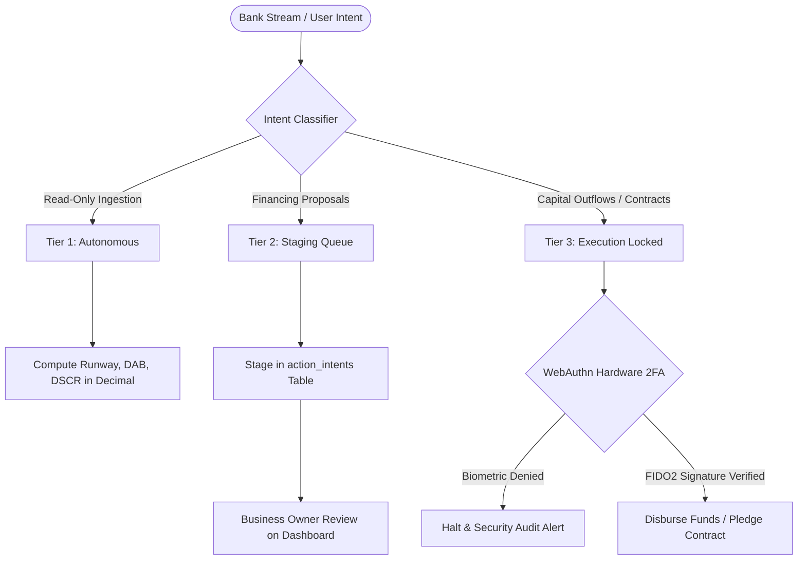

# SME Finance Copilot

> **Autonomous AI CFO & Financial Participant for Small & Medium Enterprises**  
> *FinTechathon 2026 Topic E: AI as a Financial Participant (Tsinghua University PBCSF & WeBank)*

[](https://www.python.org/)
[](https://fastapi.tiangolo.com/)
[](https://nextjs.org/)
[](https://web.dev/progressive-web-apps/)
[](https://soliditylang.org/)
[](https://fisco-bcos.org/)
[](LICENSE)

**Current demo**: a local, read-only CSV cash review. The broader PWA, WebAuthn and integrations described below are architecture targets, not verified live capabilities.

---

### Project status and documentation map

The repository contains both a small first-demo contract and a much broader architecture blueprint. Coding agents should first read [`AGENTS.md`](AGENTS.md) for instruction precedence and verified status, then [`docs/team_execution_plan.md`](docs/team_execution_plan.md) for the demo contract and task boundaries. The current code and tests—not the broader design references in [`docs/system.md`](docs/system.md), [`docs/architecture.md`](docs/architecture.md), [`docs/security.md`](docs/security.md), or the ADRs—show what is implemented. Before editing, inspect `git status` and preserve existing changes; do not commit or switch branches unless asked.

The checked-in coding-agent skills under `.agent/skills/` are repository-specific; if a task names an account-synced skill, read that exact `SKILL.md` from its supplied location and resolve any referenced files relative to it. Team task prompts set goals, acceptance and boundaries—not a prescribed UI or implementation design. Teammates may choose the approach within those constraints; coordinate before shared-contract, dependency or scope changes.

The current implementation includes a synthetic-CSV analysis endpoint and browser upload/results flow; it does not include authentication, multi-tenant database security, live bank connections, money movement, LLM integration, or blockchain execution. See [`AGENTS.md`](AGENTS.md) for checks and limitations. The wider capability diagrams below are design targets, not claims of working functionality.

- 📘 [System Design Specification](docs/system.md) — Implementation mechanics, mathematical formulations, schemas & smart contracts
- 🏛️ [Architectural Plan & Roadmap](docs/architecture.md) — 6-layer topology, 1-Supervisor + 4-Squads model & multi-agent orchestration
- 🛡️ [Security Architecture & Defense-in-Depth](docs/security.md) — 5 Invariants, threat defense, self-healing & decadal resilience
- 👥 [Team Distribution Guide](docs/team_distribution_guide.md) — first-demo kickoff, role ownership and handoffs
- ⚡ [Coding-Agent Workflow](.agent/workflows/sprint-workflow.md) — contract-first task setup, safe edits and verification
- 📜 [Architecture Decision Records (ADRs)](docs/adr/) — 7 formal architecture decision records (ADR-001 to ADR-007)

---

## 1. Executive Summary & Problem Statement

> **Status note:** This section and the architecture/security documents linked below describe the intended product and future design. For the actual first-demo scope, implementation status and teammate tasks, use [`docs/team_execution_plan.md`](docs/team_execution_plan.md) and verify claims against current code/tests.

Small and Medium Enterprises (SMEs) represent over 90% of global businesses and 50% of employment. However, **82% of SME closures stem from cash flow mismanagement and working capital timing mismatches**, rather than a lack of underlying profitability.

```
       [Raw Materials Purchased]         [Finished Goods Sold]             [Cash Collected]
  Day 0 -------------------------- Day 45 ----------------------- Day 105 -----------------
        |                                |                        |
        +-- Supplier Paid: Day 30        |                        |
            (-$30,000 cash out)          |                        |
                                         +-- Invoiced: Day 45     |
                                             ($100,000 Net 60)    |
                                                                  +-- Customer Pays: Day 105
                                                                      (+$100,000 cash in)

  ==> THE 75-DAY CASH GAP: Cash Conversion Cycle (CCC) = DIO (45) + DSO (60) - DPO (30) = 75 Days
```

Traditional commercial banks require 4 to 8 weeks to underwrite working capital loans and reject up to 80% of applicants due to a lack of physical real estate collateral.

**SME Finance Copilot** acts as a 24/7 autonomous financial participant. It monitors real-time transactional ledger streams, computes deterministic financial ratios, forecasts cash crunches before payroll bounces, matches businesses with pre-qualified working capital facilities, and registers B2B invoice pledges on consortium blockchains to prevent double-financing.

---

## 2. Core Capabilities & Product Features

```
┌─────────────────────────────────────────────────────────────────────────────────────────┐
│                                SME FINANCE COPILOT                                      │
├────────────────────────────┬────────────────────────────┬───────────────────────────────┤
│    1. CFO Health Core      │  2. Conformal Forecaster   │    3. Digital Underwriting    │
│  • Pure Decimal runway     │  • MAPIE P10/P50/P90 bands │  • WeBank Weiyidai linkage    │
│  • Daily Average Balance   │  • 30/60/90-day horizons   │  • PuLP MILP cost minimizer   │
│  • DSCR & Burn calculation │  • Kaplan-Meier DSO hazard │  • Predatory APR flag (>36%)  │
├────────────────────────────┼────────────────────────────┼───────────────────────────────┤
│   4. Three-Tier Gate       │   5. Privacy Shield        │   6. Consortium Blockchain    │
│  • Tier 1: Read-only auto  │  • Microsoft Presidio PII  │  • FISCO BCOS smart contract  │
│  • Tier 2: Proposal staging│  • IBAN & Phone redaction  │  • Canonical SHA-256 hashing  │
│  • Tier 3: WebAuthn 2FA    │  • PostgreSQL RLS isolation│  • Double-pledge prevention   │
└────────────────────────────┴────────────────────────────┴───────────────────────────────┘
```

### 2.1 Deterministic CFO Financial Health Diagnostics
- Computes exact Net Daily Burn, Cash Runway, Daily Average Balance (DAB), and Debt Service Coverage Ratio (DSCR).
- Enforces pure Python `decimal.Decimal` with `ROUND_HALF_UP` arithmetic. Prohibits mental arithmetic and LLM mathematical approximations.

### 2.2 Predictive Cash Crunch Forecasting (MAPIE Conformal Prediction)
- Generates non-parametric prediction intervals across 30, 60, and 90-day forward horizons.
- Outputs pessimistic ($P_{10}$), median ($P_{50}$), and optimistic ($P_{90}$) cash corridors at 90% empirical coverage, alerting business owners before deficits occur.
- Uses Kaplan-Meier survival curves to estimate customer invoice settlement delays (DSO).

### 2.3 Intelligent Digital Underwriting & Financing Matcher
- Replaces static annual tax returns with high-frequency transactional data streams (inspired by WeBank's *Weiyidai* credit assessment model).
- Evaluates Revenue-Based Financing, Invoice Factoring, and Working Capital Lines.
- Runs a PuLP Mixed-Integer Linear Program (MILP) to minimize financing costs.
- Enforces Truth-in-Lending rules: converts factor rates into true APR and flags any facility exceeding 36% APR as predatory.

### 2.4 Consortium Blockchain Invoice Double-Pledge Prevention
- Generates canonical `SHA-256` content hashes from invoice metadata:
  $$\text{InvoiceHash} = \text{SHA-256}(\text{TaxID} \parallel \text{BuyerID} \parallel \text{InvoiceNum} \parallel \text{AmountCents})$$
- Submits verification payloads to `InvoiceRegistry.sol` on FISCO BCOS to prevent fraudulent invoice double-financing across multiple lenders.

---

## 3. Provable Reliability, Security & Trust

Autonomous financial participants require mathematical guarantees, not heuristic promises. SME Finance Copilot enforces five standing security invariants:



| Security Dimension | Implementation Mechanism | Business & Audit Guarantee |
|---|---|---|
| **0% LLM Math** | Isolated calculation engine in `services/calculations/` | Eliminates hallucinations in interest calculations, runway estimates, and debt service ratios. |
| **Three-Tier Gate** | Pydantic v2 schemas with `extra="forbid"` in `services/security/` | Prohibits unauthorized money movements. System stages intents; capital transfers require physical confirmation. |
| **WebAuthn Biometrics** | FIDO2 challenge verification bound to browser cryptographic keys | Requires TouchID, FaceID, or hardware security keys for live fund disbursement or loan execution. |
| **Privacy Shield** | Automated PII scrubbing in `services/ingestion/` | Redacts IBANs, bank account numbers, and phone numbers before data enters storage or LLM context. |
| **Tenant Isolation** | PostgreSQL Row-Level Security (RLS) on `tenant_id` | Enforces database-level multi-tenant boundaries; prevents cross-tenant data leakage or IDOR parameter tampering. |

---

## 4. System Architecture & Form Factor

### 4.1 Form Factor Decision: Responsive Web + Progressive Web App (PWA)
We selected a Responsive Web Application with Progressive Web App (PWA) packaging over native desktop or mobile binaries:
1. **Zero Download Friction**: Business owners access the dashboard from any browser immediately without app store review delays.
2. **Instant Security Patching**: Financial logic updates deploy in 0 seconds without requiring client-side binary re-installations.
3. **Native Hardware Biometrics**: Leverages standard W3C WebAuthn APIs for TouchID and FaceID hardware authentication directly in Chrome, Safari, and Edge.
4. **Minimal Attack Surface**: Eliminates binary reverse-engineering risks associated with shipped Electron or Flutter packages.

### 4.2 Macro Topology

```
┌────────────────────────────────────────────────────────────────────────┐
│ 1. DATA INGESTION: Open Banking CSV, Plaid Webhooks, VAT E-Invoices     │
├────────────────────────────────────────────────────────────────────────┤
│ 2. PRIVACY SHIELD: Microsoft Presidio PII Masking (IBANs, Phones)      │
├────────────────────────────────────────────────────────────────────────┤
│ 3. DETERMINISTIC CORE: Python decimal.Decimal (Runway, DAB, DSCR)       │
├────────────────────────────────────────────────────────────────────────┤
│ 4. RISK & FORECASTING: MAPIE Conformal Corridor + Kaplan-Meier DSO      │
├────────────────────────────────────────────────────────────────────────┤
│ 5. SECURITY GATE: 3-Tier Permission Matrix + WebAuthn FIDO2 Verifier    │
├────────────────────────────────────────────────────────────────────────┤
│ 6. CONSORTIUM ANCHOR: FISCO BCOS InvoiceRegistry.sol (PBFT Consensus)   │
├────────────────────────────────────────────────────────────────────────┤
│ 7. PRESENTATION: Next.js 14 Executive Dashboard (tabular-nums, PWA)    │
└────────────────────────────────────────────────────────────────────────┘
```

---

## 5. Hackathon Rubric Alignment

| Evaluation Criteria | Weight | How SME Finance Copilot Delivers |
|---|---|---|
| **Task Completion** | **40%** | Ingests bank transaction streams, computes exact financial ratios, forecasts cash deficits 30-90 days in advance, and constructs pre-qualified working capital proposals. |
| **Defensive Security & Compliance** | **30%** | Three-Tier Security Gate isolating read-only analytics from capital movement, WebAuthn physical biometric 2FA, Presidio PII redaction, and Truth-in-Lending APR disclosures. |
| **Technical Innovation** | **30%** | WeBank-inspired continuous cash flow underwriting, MAPIE distribution-free conformal forecasting, and consortium blockchain invoice pledge anchoring. |

---

## 6. Local Demo Setup & Verification

### Prerequisites
- Python 3.11+ (the API and tests)
- Node.js 18+ and npm (the frontend; `package-lock.json` pins the dependency tree)

### Step 1: Clone the repository
```powershell
git clone https://github.com/SamJU25/F-SME-Finance-Copilot.git
cd F-SME-Finance-Copilot
```

### Step 2: Create an isolated Python environment
Use a virtual environment so project dependencies do not change your system Python. In PowerShell:
```powershell
python -m venv .venv
.\.venv\Scripts\Activate.ps1
python -m pip install --upgrade pip
python -m pip install -r requirements.txt
```
On macOS/Linux, activate it with `source .venv/bin/activate` instead. If PowerShell blocks activation, run the environment's Python directly as `.venv\Scripts\python.exe -m pip install -r requirements.txt` and `.venv\Scripts\python.exe -m pytest -q`.

### Step 3: Install frontend dependencies
Run from the repository root; `npm ci` uses the committed lockfile and should not be replaced by `npm install` for a reproducible setup.
```powershell
npm ci
```

### Step 4: Start the connected local demo
Open two terminals at the repository root and activate the Python virtual environment in the API terminal. In terminal 1:
```powershell
python -m uvicorn api.main:app --host 127.0.0.1 --port 8000
```
In terminal 2:
```powershell
npm run dev -- --hostname 127.0.0.1 --port 3000
```
Open <http://127.0.0.1:3000>, download the [synthetic sample CSV](public/synthetic-statement.csv), and upload it. The API health check is <http://127.0.0.1:8000/api/v1/health>. The browser calls `NEXT_PUBLIC_API_BASE_URL` (default `http://localhost:8000`). Set it before starting Next.js in development or before building for production if the API is at another origin; use a base URL without a trailing slash. `MAX_ANALYSIS_UPLOAD_BYTES` optionally configures the API upload cap (positive integer; default `1048576`, or 1 MiB). The current API CORS allowlist is limited to `http://localhost:3000` and `http://127.0.0.1:3000` in `api/main.py`.

For a same-LAN demo only, bind both servers to `0.0.0.0`, set `NEXT_PUBLIC_API_BASE_URL` to the API machine's reachable IP (for example, `http://192.168.1.20:8000`), and add the exact frontend browser origin (for example, `http://192.168.1.30:3000`) to the API's `allow_origins` list in `api/main.py`. The API URL must be reachable from the browser, and CORS must match the frontend origin—not the API origin. Allow the ports only on a trusted local network; do not expose this unauthenticated demo to the public internet.

### Configuration

| Variable | Used by | Default | Purpose |
|---|---|---|---|
| `NEXT_PUBLIC_API_BASE_URL` | Next.js frontend | `http://localhost:8000` | API origin; set before starting Next.js or running `npm run build`. Use an origin without a trailing slash. |
| `MAX_ANALYSIS_UPLOAD_BYTES` | FastAPI API | `1048576` (1 MiB) | Positive-integer limit for one CSV upload. Set before starting Uvicorn. |

### Step 5: Verify the checkout
Run these commands from the repository root (with the Python virtual environment active):
```powershell
pytest -q
npm run type-check
npm run build
```
The browser upload path is a demo against synthetic files; passing tests and frontend checks do not establish production security, financial suitability or a regulated forecast. GitHub Actions runs these backend tests and frontend checks on pushes and pull requests via [`.github/workflows/ci.yml`](.github/workflows/ci.yml); the local commands above remain useful before you hand off a change.

### Optional: Refresh the knowledge graph
The code graph is generated navigation data, not a source of truth. If Graphify is installed in the Python environment, `python -m graphify update .` refreshes the code graph, not the semantic wiki. See [`AGENTS.md`](AGENTS.md) for the last checked graph totals and extraction caveats; the Graphify wiki index currently warns that its articles are stale.
```powershell
python -m graphify update .
```

---

## 7. Team kickoff and coding-agent handoff

The first-demo pipeline is already integrated; teammates should start from the code and tests that exist, not assume that planned blueprint services are starter backbones. The [team execution plan](docs/team_execution_plan.md) contains the shared CSV/API contract, current implementation status, actual owner paths and test locations, plus a short task-brief template and copy-ready prompts. The [team distribution guide](docs/team_distribution_guide.md) explains how the lead assigns work and integrates handoffs. The [CI workflow](.github/workflows/ci.yml) runs backend tests and frontend type/build checks on pushes and pull requests; this validates the current demo baseline, not deferred blueprint capabilities.

For each coding-agent task, the lead supplies the user outcome, observable acceptance checks, owner and scope boundaries. The prompt intentionally leaves design and implementation choices to the teammate within the agreed contract. A folder boundary can reduce overlapping edits, but it cannot guarantee conflict-free or semantically compatible merges; review and test the integrated changes before the demo.

---

## 8. License & Competition Notice

This project is developed for **FinTechathon 2026 Topic E: AI as a Financial Participant**, organized by Tsinghua University PBCSF and WeBank.

Distributed under the MIT License. See [`LICENSE`](LICENSE) for details.
